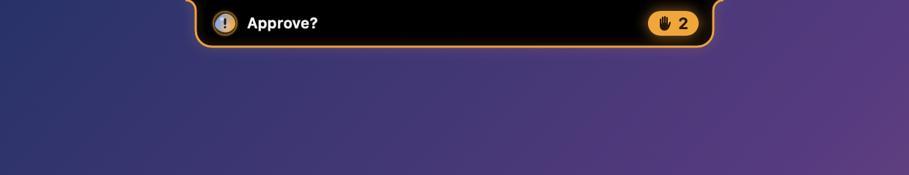
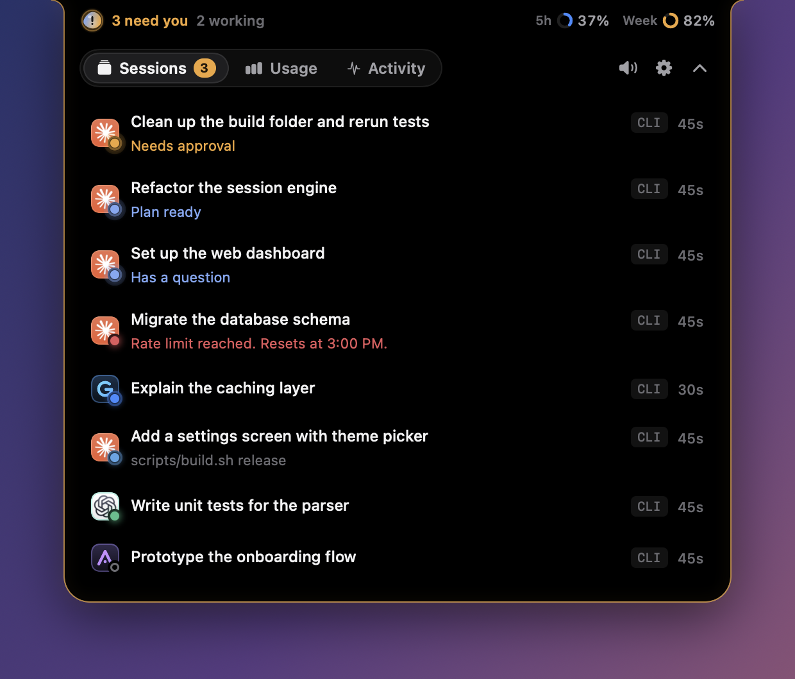
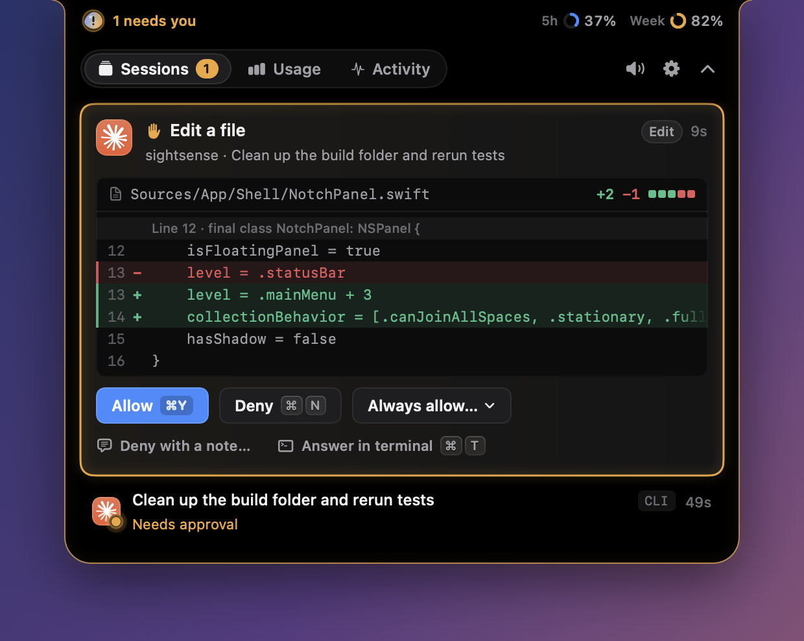
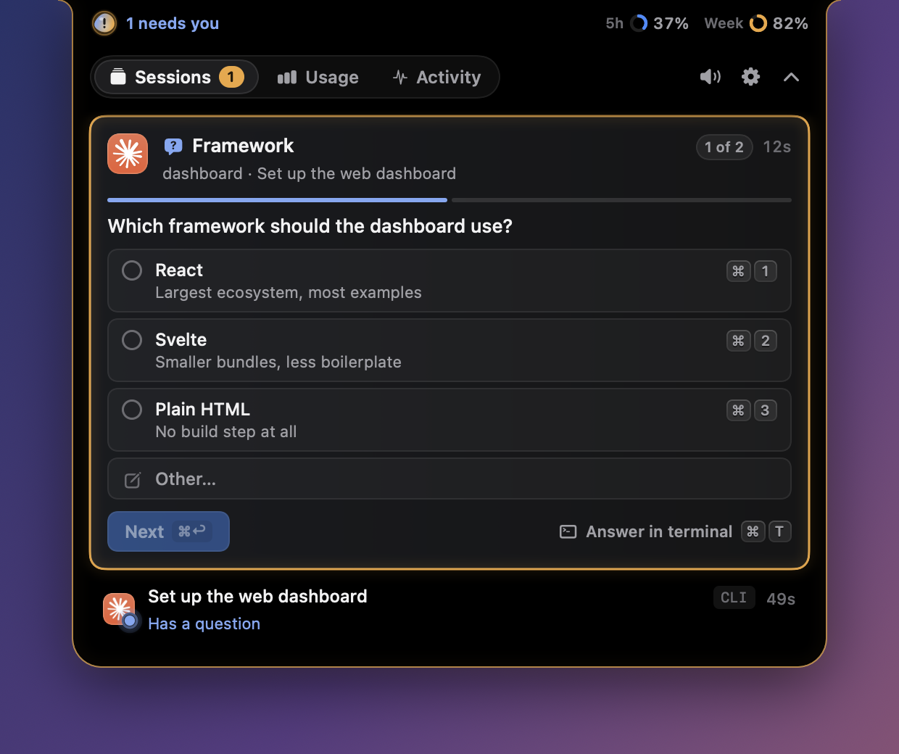
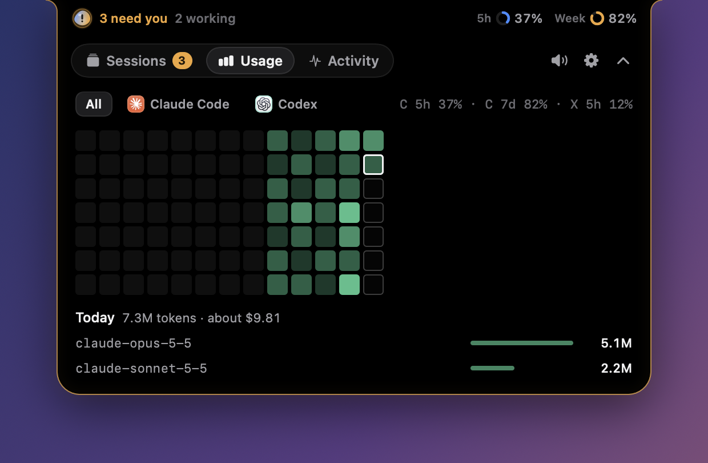
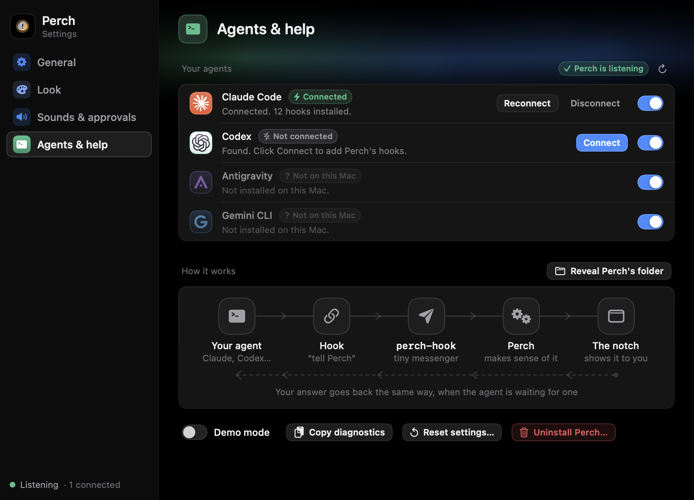

# Perch

Perch is a small Mac app that lives in the MacBook notch and shows what your AI coding agents are
doing. When an agent needs you — permission to run a command, an answer to a question, a plan to
approve — the notch tells you and lets you answer right there. One click on a session takes you to
its terminal tab. It also shows how much of your usage limits you have used.

It is original code with no third-party libraries, no network access, no analytics and no access
to your logins or keychain. If Perch is closed, your agents behave exactly as if it were not
installed.





| Approving an edit | Answering a question |
|---|---|
|  |  |

| Usage, one square per day | Connecting agents |
|---|---|
|  |  |

*Screenshots use sample data.*

## Install

You need a Mac with a notch-era macOS (15 or later) on Apple silicon, and the Xcode Command Line
Tools. There is no downloadable build yet; you build it yourself, which takes about a minute.

```bash
xcode-select --install          # skip if you already have the Command Line Tools
```

```bash
git clone https://github.com/ConnorSawaya/perch.git
```

```bash
cd perch && scripts/install.sh
```

`scripts/install.sh` builds the app, copies it to `/Applications` and opens it. Then:

1. Click the bird in the menu bar → **Settings** → **Agents & help**.
2. Click **Connect** next to Claude Code (and Codex, if you use it). Codex asks you to trust the
   new hooks the next time you open it.
3. Start a session. It appears in the notch.

To update later: `git pull && scripts/install.sh`.

## How it works

Coding agents can run a small program of your choice whenever something happens (a session
starts, a tool is about to run, permission is needed). That is called a *hook*.

1. When you click **Connect** for an agent, Perch adds a few lines to that agent's own settings
   file telling it to run Perch's helper, `perch-hook`, on those events. A dated backup of the file
   is saved first and nothing else in it is changed.
2. Each time the agent fires an event it runs `perch-hook`, which passes the event to the Perch
   app through a private socket on your Mac and exits. This takes about 4 thousandths of a second.
3. Inside the app, an *adapter* for that agent translates the event into Perch's common language,
   and the *session engine* turns the stream of events into the cards you see in the notch.
4. For a permission prompt the helper does not exit: it waits. Your click on **Allow** or **Deny**
   travels back the same way, the helper prints the answer in the form the agent expects, and the
   agent carries on. The agent's own prompt in the terminal keeps working the whole time;
   whichever is answered first wins.

If the app is not running, the helper notices at once, prints nothing and exits, so the agent
simply shows its normal prompt.

## What works with each agent

| | Live sessions | Allow / Deny | Questions | Plan review | Usage | Jump to terminal |
|---|---|---|---|---|---|---|
| **Claude Code** | yes | yes | yes | yes | yes | yes |
| **Codex** | yes | yes | shown, answer in terminal | shown, answer in terminal | yes | yes |
| **Antigravity** | yes | no (it allows watching only) | no | no | no | yes |
| **Gemini CLI** | yes | no (it offers no way) | no | no | no | yes |

Only Claude Code has been tested end to end against the real thing (version 2.1.296). Codex,
Antigravity and Gemini CLI support was written from their documentation and tested with sample
payloads, so expect rough edges there.
For Claude Code, connecting also routes its status line through a small Perch script (that is how
context and limit readings arrive); your own status line still runs and Disconnect puts it back.

Each session is tagged **CLI** (running in a terminal) or **App** (running in a desktop app).
Sessions started by scripts with no terminal (for example `claude -p`) are hidden.

## Where everything lives

| What | Where |
|---|---|
| The app | wherever you put `Perch.app` (normally `/Applications`) |
| Perch's folder | `~/Library/Application Support/Perch/` |
| — the helper agents run | `bin/perch-hook` (copied there on every launch) |
| — Claude Code status line script | `bin/perch-statusline.sh` |
| — the socket | `perch.sock` (exists only while Perch runs) |
| — backups of agents' settings files | `backups/` |
| — usage statistics | `data/` |
| — the log | `logs/perch.log` |
| Preferences | the system's store for `local.perch.app` |
| Lines added to agents | `~/.claude/settings.json`, `~/.codex/hooks.json`, `~/.gemini/settings.json`, `~/.gemini/config/hooks.json` — only after you click Connect |

## Building

You need the Xcode Command Line Tools; nothing else.

```bash
scripts/build.sh            # builds build/Perch.app (add "release" for an optimised build)
scripts/test-all.sh         # every test suite
scripts/e2e.sh              # the built app, driven through the real helper with recorded events
scripts/e2e-claude.sh       # the built app with the real Claude Code CLI (two short haiku runs)
scripts/smoke.sh            # a first launch for a few seconds, plus hook timing
scripts/make-icon.sh        # redraw Resources/AppIcon.icns (the icon is drawn in code)
build/Perch.app/Contents/MacOS/Perch --snapshot <folder>   # draw every screen to PNG files
```

The test scripts never touch your real setup: they start the app with `PERCH_HOME=<temporary
folder>`, which moves all of Perch's files and preferences there, and `PERCH_NO_LOGIN_ITEM=1`.
A copy of Perch started with `PERCH_HOME` refuses to change any agent's settings file.

## Permissions

macOS may ask two things, both optional: permission to control your terminal app (the first time
you click a session to jump to its tab) and permission to show notifications (only if you turn
notifications on). Perch opens at login; turn that off under Settings → General.

## Uninstalling

Settings → Agents & help → **Uninstall…** does all of this, then quits:

- takes Perch's lines out of every connected agent's settings file (everything else stays);
- moves everything in Perch's folder to the Trash — helper, statistics, logs and the backups of
  your settings files (they stay in the Trash until you empty it);
- forgets Perch's preferences and removes it from Login Items.

Then drag `Perch.app` to the Trash. To disconnect a single agent instead, use Settings → Agents & help →
Disconnect.

## Where to look in the code

| Folder | What is in it |
|---|---|
| `Sources/Contract/` | the shared vocabulary: data types, stores, settings, the helper ↔ app message format |
| `Sources/Helper/` | `perch-hook`, the tiny program agents run |
| `Sources/Core/Runtime/` | the socket server, and copying the helper into place |
| `Sources/Core/Adapters/<Agent>/` | everything specific to one agent: its formats, its settings file |
| `Sources/Core/Engine/` | turns events into session state; looks after waiting requests |
| `Sources/Core/Usage/` | limits, tokens and estimated cost, read from files the agents already write |
| `Sources/Core/System/` | jumping to terminal tabs, sounds, notifications, open-at-login |
| `Sources/App/Shell/` | the notch window, the menu-bar icon, the Settings window, keyboard shortcuts |
| `Sources/App/Design/` | colours, themes and shared controls |
| `Sources/App/Panel/`, `Cards/` | the pill, the open panel, and the approval / question / plan / usage / activity cards |
| `Sources/App/Settings/` | the Settings screens, including "How it works" |
| `Sources/App/Demo/` | demo mode, and drawing every screen to PNG files |
| `Sources/App/Main/` | start here: `AppController.swift` builds every part and connects them; `AppController+Actions.swift` is what each button does |
| `Tests/`, `Fixtures/` | the test suites and the recorded agent events they replay |

Every source file starts with a short comment saying what it is for. `ARCHITECTURE.md` has the
whole picture on one page.
